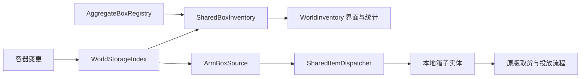

# OmniMod 架构审查与本轮重构

> 2026-11-02 更新：`entity16` 已将实体保存与取用改为独立的全局池。下文保留当时审查和恢复证据；当前行为以 [全局实体池重构](entity-pool-refactor.md) 为准。

审查日期：2026-11-01。依据：Antigravity 对话 `Unity Game Crash Troubleshooting`（`da544d11-c786-4263-b648-bdf2d4585489`，记录截至步骤 20904）、当前源码、已安装游戏 744825 的程序集及本机日志。

## 固定的产品规则

- 杂物箱、食物箱分别是全星系共享资源的入口，库存不按星球均分；新增箱子不复制资源。
- 普通物资经本世界对应箱子取用。远端实体按需求调拨到本地入口，普通储物箱的库存不自动成为全星系共享库存。
- 小动物、瓶装液体和瓶装气体允许机械臂跨世界取用；投放位置仍受机械臂原有工作范围约束。
- 复制人保持原版移动和取货流程；共享库存查询不代替寻路，也不强行改复制人的位置。
- 种子、蛋、装备按游戏的单位数量处理；保留预约、私人库存、分配归属和活物白名单。

对话中的明确依据：步骤 1647、1962、2300、5455，以及最后阶段“箱子是共享入口、普通物品取本地箱子、动物及瓶装液气跨星球取用”的用户纠正。

## 审查发现与本轮处理

| 问题 | 证据和后果 | 本轮处理 |
|---|---|---|
| 注册表兼任索引、界面统计、调拨和按需物化 | `AggregateBoxRegistry` 超过一千行；改一处取货规则容易影响数量显示 | 拆成注册、索引、共享查询、调拨、匹配五个职责 |
| 本地可取货容器与共享库存混用 | 原索引包含普通储物箱、装瓶器；共享汇总读取同一份世界总数 | 保留本地来源索引；另记聚合箱数量，合并实体时再次核对实际箱子归属 |
| 通过母星回退把同一个箱子记入多个世界 | 原索引构建调用带母星回退的箱子查找函数 | 索引只收录物理位于目标世界的容器；本地入口按世界和箱子类型直接查表 |
| 没有本地入口也获得共享权限 | `isPocket` 为真时直接通过权限检查 | 共享查询、状态提示和普通物资远程取货采用同一本地入口规则 |
| 共享集合被重复扩展 | 原版关联世界查询会逐世界调用 `GetPickupables`，每一层又追加全共享池 | 两个关联世界查询重载均在外层合并一次；异常退出也恢复查询作用域 |
| 两个库存补丁实际挂载失败 | `Player.log` 记录失败；原补丁参数名与游戏实际参数名不同 | 改按参数位置绑定，并保留明确的重载选择 |
| 失败缓存跨任务相互影响 | 缓存只用物品标签作键，一个目的地失败会临时阻挡其它目的地 | 改为任务弱引用、来源世界、任务标签条件和失效代数；新库存通知使缓存失效 |
| 跨星调拨匹配了错误的分配世界 | 原候选检查使用来源世界，而物品实际要运到目的地世界 | 分配归属对照目的地；远端普通物品只从共享箱调拨 |
| 世界索引与容器订阅未完整清理 | 原退出存档只清快照，仍保留容器映射和匿名订阅 | 显式登记、解除容器监听，并在游戏清理时释放索引和箱子注册信息 |
| 种子物化有三套实现 | 旧种子迁移、机械臂取货和离散补货各自扣池、生成实体 | 合并到 `SharedItemDispatcher.MaterializeSeeds`，先验证预制体，再返回 Store 合并后存活的实体 |
| 遗留均分器只是空方法 | `FoodBalancer` 已无实际逻辑，但每个食物箱仍调用 | 删除空调用和未参与存档的静态空类，移除闲置的退回入口 |

## 当前代码职责

| 类型 | 职责 |
|---|---|
| `AggregateBoxRegistry` | 箱子注册、世界与类型查找、唯一性与格子索引 |
| `WorldStorageIndex` | 容器变更监听、分帧建表、本地来源和聚合箱数量快照 |
| `SharedBoxInventory` | 共享权限、数量缓存、共享实体合并；不搬动物品 |
| `SharedItemDispatcher` | 实体按需调拨、分配归属、种子及电池供给 |
| `ArmBoxSource` | 按搬运任务匹配本地来源、按需物化固体 |
| `RemoteFetchFailures` | 短时缓存空查询，按任务与世界隔离 |
| `WorldInventoryPatch` | 将上述只读查询接入游戏的库存和界面接口 |
| `GlobalItemCollector` | 地面收集与库存维护调度 |

索引每帧处理预算沿用原来的约 2ms，上限 256 个候选；建表期间继续提供上一份完整快照。共享数量单独索引，实体列表复用本地标签索引后核对来源，不复制第二套完整物品列表。普通取货和调拨执行前重新核对实体存活、当前容器、预约和世界。

上一轮的多箱共用散落物扫描与维护分片继续保留；本轮的定点耗时记录已随类拆分更新入口。包含子调用的方法耗时不可直接相加。

## 存档兼容边界

`OmniMod.Pool.OmniPool`、`OmniMod.Collection.GlobalItemCollector`、现有建筑 ID 和它们的序列化字段保持兼容。新增职责类均为运行时静态服务。已经停用的 `ConduitGuardian` 仍保留旧序列化类型和字段，避免旧存档失去类型定义；不恢复其补水逻辑。

## 仍需继续审查的部分

- 生态舱世界管理已完成后续一轮重构，见 `docs/pocket-world-refactor.md`：新增组件归属、完整矩形及逐格校验，改为只补门、精确回收，并重构诊断缓存与旧档缓冲准备。历史损坏数据及原生模拟载入兼容仍需单独确认。
- `ConduitAntiBurstPatch` 会直接钳制管内流体温度，属于游戏行为调整，应与管道丢失原因诊断分开记录；本轮未改变该规则。
- 全局动画及标签防空补丁、界面异常抑制还应逐步缩小作用范围。捕获异常只能阻止该次异常继续传播，不能证明此前没有发生部分状态修改。
- 动物监视器处理超限、游戏模拟与机械臂等耗时需要重启后的诊断日志确认占比。历史对话多次宣布卡顿根除，之后仍收到复发反馈，不能沿用那些结论作为运行验证。

本轮验证采用源码调用关系审查、旧序列化类型核对和 Release 编译。没有运行游戏或新增测试。实际卡顿改善、跨舱取货和数量显示需由用户正常游玩及新日志确认；部署记录与编译结果另在本次交付中说明。
