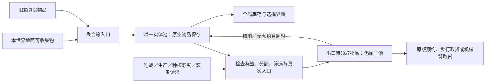

# 全局实体池重构（entity16）

> 后续修正：`material17` 已取消每星球材料预存，并将材料出口纳入统一归属与复制人施肥取货。当前材料规则见 [材料供给修复](material-supply-fix.md)。

2026-11-02，针对本机 ONI 744825；构建标识 `fix-20261102-entity16`。这是 `food15` 之后的存储模型更新；此前关于“各星球箱子实物相加、跨箱调拨、主箱保管离散物品”的说明不再代表当前实现。

## 产品规则与实际保存位置

材料继续使用 `OmniPool` 的元素／温度桶；种子、蛋、增幅块、装备、食物和其它可收集的固体实体统一存入独立的 `OmniEntityPool`。聚合箱是入口与出口，不再独立拥有一份星球库存。普通储物柜、机器私库和复制人随身物品不自动归池；重复且停用的箱子保持原有的本地储存行为。

`OmniEntityPool : Storage` 在 `SaveGame.OnPrefabInit` 添加，以独立组件名持久化。原版 `Storage.ISaveLoadableDetails` 保存真实物品的 `SaveLoadRoot` 及其组件／嵌套物品，池内物品取消顶层单独登记，避免重复保存。不把变异、分析进度、孵化进度、分配关系、调味、新鲜度、温度和病菌压成类别加数量。入池、回池及门户出库禁止自动吸收合堆；需要拆堆时仅使用原版 `Pickupable.Take`／`EntitySplitter` 及其分割回调，原堆与分堆遵守游戏原生状态复制规则。

保存根的坐标不作为物品坐标。入池保留物品最后的有效位置，`Pickupable.OnStore` 和后续缓存刷新针对本池读取物品位置；释放旧生态舱后，分片维护会把失效的隐藏坐标重新锚定到现存入口。池内物品始终私有、不可直接原地取货，界面可以读取它们，实际领取必须经过门户。

## 出库、预约与归还

- 生产、种植、孵蛋和展台通过实际 `FetchChore` 的完整标签条件出库；不再依据 `MaterialNeeds` 的世界合计提前调入。机械臂使用同一池接口，普通物品要求本世界入口，投放范围保持原版约束。
- 吃饭接入 `FindEdibleFetchTarget`，仅在原版无结果、本人已饥饿、查询使用实际禁食集合时介入；保留饮食许可、正热量、门户筛选、自动化限制和步行可达检查。按个人热量缺口出库，诊断性的空禁食查询不会领取食物。
- 增幅块和装备保留真实 `Assignable`，分配时经目标入口出库；旧档已分配物品会按实际所有人的可达入口恢复领取。便携电池和固体润滑剂接入各自的个人用品查找流程，不再每十秒扫描全部复制人、分配物品及任务来预存物品。
- 排他预约由原版 `Pickupable` 管理。池不会移动已有预约的物品。出口物品在被实际拿走前仍只计为一份全局库存；实际离开出口进入工作者／机器后解除池归属，剩余的原堆保持原量更新。
- 已结束的 `FetchChore` 释放自身出库记录；没有预约的物品随后归还。其它未领取出库物品在 30 个模拟秒后回池；仍被原版预约或仍有效分配给本世界所有人的物品不被抢回。读档不恢复过期的临时请求指针，出口实物重新接管，原生任务继续重新预约。
- 拆入口前先归还未预约实体；仍在有效搬运中的物品交给原版取消／掉落流程，不强行删除预约。已在中央库的库存不受入口拆除影响。关闭入口筛选只限制进出，不再从全局池向地面倾倒库存。

蛋在普通储存里原本会每秒损失 `1/60` 活力。池与出口等候期间通过不写入存档的专用效果抵消这项已核对的原版损耗，保留现有孵化进度；真正离开共享存储后移除效果，孵化器继续走原版规则。防腐、绝热、隐藏沿用共享存储的行为，不设置会干扰热量显示的 `Sealed` 标签；挥发组件也识别新池。

活体动物、袋装动物和瓶装液气继续使用原有专门取货路径；它们不被普通固体实体池吞入。此轮没有修改已完成的生态舱世界分配、房间效果和动物／瓶装流体跨世界取货规则。

## 迁移与数量一致性

首次读旧档时，登记生效箱内的实体归属，利用统一分片预算迁入中央库；不删除再生成旧实体。已预约的物品留给当前原版任务，空闲后再迁移；新增收集物直接入池。尚未迁走的出口／旧箱物品已属于同一账本，不能同时算本地库存和共享库存。旧的纯数量种子字段仅作为兼容输入，逐种创建普通种子、成功入池后扣旧账；失效的旧预制体条目保留原账，不阻挡其它有效条目。旧数量池没有保存过的变异与分析状态无法从数量恢复，现存真实实体不走这个兼容分支。

全局账本分别记录游戏单位数量与千克；同时具有烹饪原料和种子性质的实体在两种入口均可访问，但拥有两种入口的世界只计一次。计数内部使用双精度，避免频繁小份出入累积误差。界面查询只读；本地非池物品与全局账本合并，不再把旧的异步本地数量减去实时出口量。带禁用变种标签的查询额外补入中央库内匹配的实体。

## 性能约束与文件职责

中央库维护每次最多 32 个实体、约 1 ms 预算；候选按标签定位，每个请求每次最多检查 128 个候选，并延续游标。查询失败限频一秒且同帧不重复；库存变更可提前重试。复制人的重试状态按任务和导航者分别存储，电池／润滑剂按本人和类别分别存储，防止一个不可达工作者或一种用品阻挡另一种。数量缓存读取不遍历全池；本地数量查询按帧和池版本缓存。

旧 `DiscreteHome`、定时全任务需求扫描、跨星球箱子 donor 循环、分散的种子物化路径、无调用的世界共享质量快照已移除。`WorldStorageIndex` 仅继续提供本地容器的取货候选，保留此前的分帧预算。

| 文件 | 职责 |
|---|---|
| `Storage/Entities/OmniEntityPool.cs` | 原生保存、实体归属与标签索引、出库／回池、迁移与分片维护 |
| `Storage/Entities/EntityPoolAccess.cs` | 具体请求的筛选、分配归属、可达入口与候选预算 |
| `Storage/Entities/EntityPoolPatches.cs` | 原版存取通知、坐标保护、生产与个人用品取用、取消和拆除衔接 |
| `Storage/Registry/SharedBoxInventory.cs` | 门户访问权与全局只读库存视图 |
| `Logistics/Dispatch/SharedFoodSupply.cs` | 独立的原版吃饭入口适配 |

## 交付与验证边界

仅执行当前游戏程序集静态核对、源码检查、Release 编译及安装文件校验；遵照用户要求，没有新增测试，没有启动或操作游戏。编译成功不代表已在游戏中验证所有原版及第三方建筑。迁移、领取和重新保存仍需用户正常游玩确认。

部署前配套备份旧 DLL、PDB、YAML、最新原存档及其预览，并记录 SHA-256；实际位置见本次 `deployment.json`。新版本第一次保存后，实体会写入新的池组件；若回退旧 DLL，应同时使用配套迁移前存档，旧 DLL 没有读取新池的能力。

## 本次交付状态（2026-11-02）

用户明确批准安装后，`fix-20261102-entity16` 已安装到现有游戏 Mod 目录。DLL、PDB、两个 YAML 与本次 Release 产物逐文件 SHA-256 一致；Release 编译为 0 警告、0 错误。DLL SHA-256：`bc70a6cb0e1c43c182ea1cd51d05fd9f46057ca2c68f7ba89f2a68a0c2f35b23`。安装包：`omniOxygenNotIncludedMod/bin/Release/OmniMod-entity16.zip`，内容与已安装版本一致。

安装前已保全旧版四个 Mod 文件、最新第 243 周期原存档及预览、修改前源码。配套备份：`~/Library/Application Support/unity.Klei.Oxygen Not Included/recovery_backups/2026-11-02-entity16-015111`；同目录 `deployment.json` 记录校验值和原路径。项目内最初准备阶段的第 242 周期备份也保留。自动授权审核此前两次超时，用户明确批准后已完成安装，不再处于等待安装状态。

本次未启动或操作游戏、未新增或运行测试、未修改任何原存档。已运行的游戏进程仍使用其载入时的 DLL；保存退出并重新启动后，新版会在加载存档时接管旧箱实体。若使用旧 DLL 回退，应同时使用上述配套迁移前存档。
